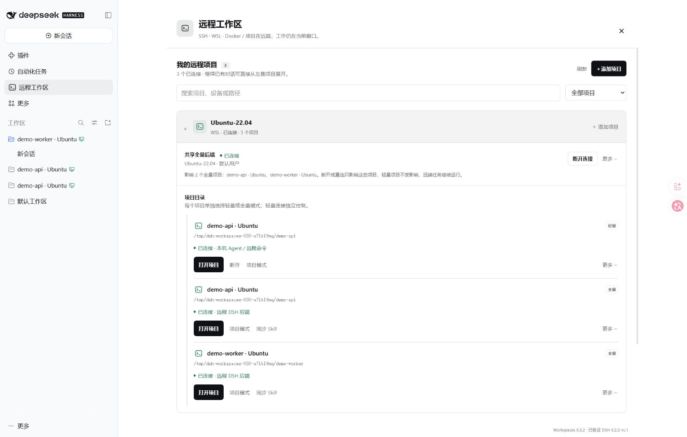
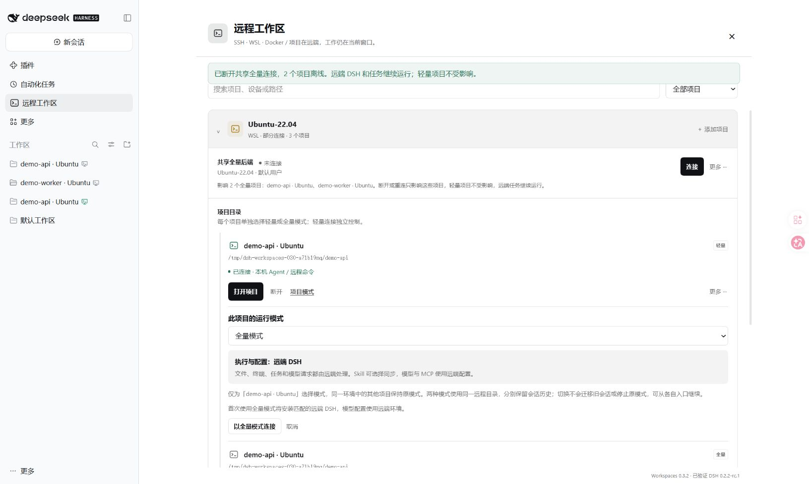
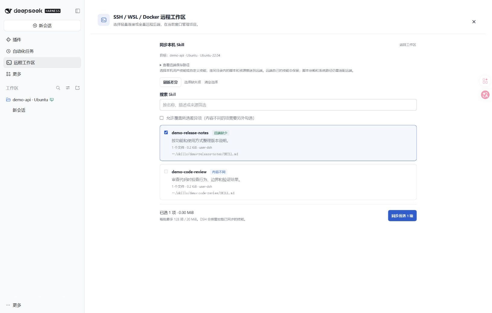
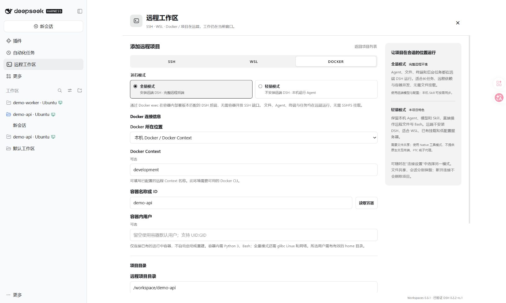
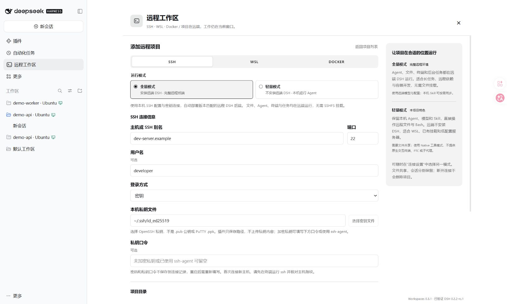
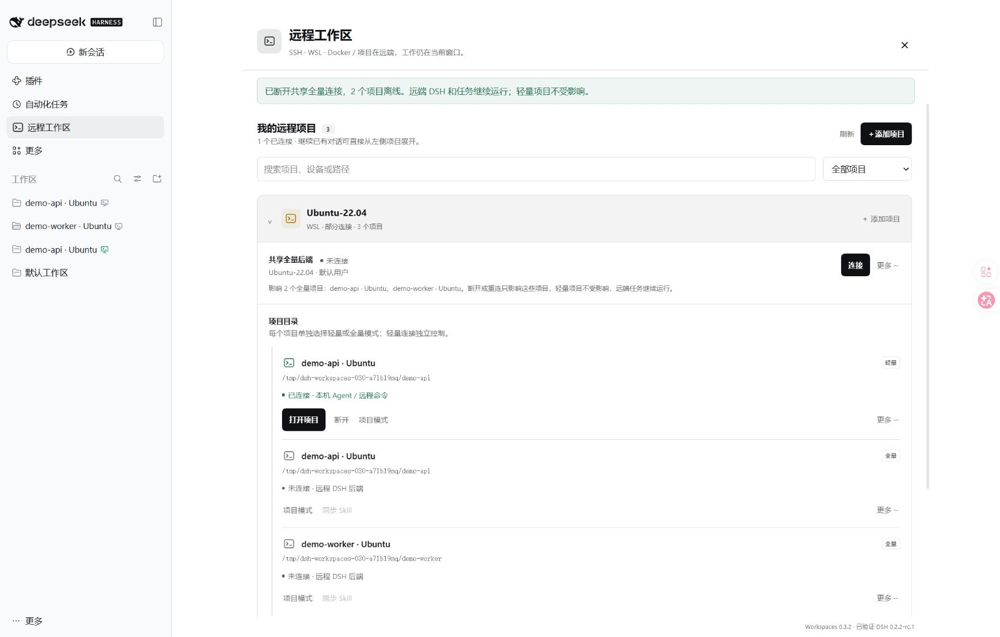

# DSH SSH / WSL / Docker Workspaces

**把 SSH 服务器、WSL 和 Docker 容器里的项目，直接放进 DeepSeek Harness 当前窗口的项目侧栏。**

不用为每台机器再打开一个 DSH 窗口。在左侧 **远程工作区** 中添加目录，就能与本机项目一起管理。需要完整的远程开发环境时，让 Agent、终端和任务在远端 DSH 中运行，并按需把本机 Skill 同步过去；希望保留本机 Agent 和模型配置时，可以使用本项目的**轻量模式**。

[npm 安装包](https://www.npmjs.com/package/dsh-ssh-workspaces) · [使用指南](https://github.com/czp0312/dsh-ssh-workspace/blob/main/docs/usage.md) · [问题反馈](https://github.com/czp0312/dsh-ssh-workspace/issues) · [MIT License](https://github.com/czp0312/dsh-ssh-workspace/blob/main/LICENSE)



> 截图来自真实 DSH 和 WSL 连接，使用独立的公开演示项目。
>
> 0.3.3 已调整管理界面布局，当前截图采集自 0.3.2，0.4.0 的主机指纹面板尚未实机截图。

## 可以做什么

### 远程项目，也在原生侧栏里

- **同一个窗口管理本机、SSH、WSL 和 Docker 项目**：使用 DSH 原生工作区和会话列表。
- **独立的左侧入口**：点击「远程工作区」即可添加、浏览和管理连接。
- **环境下管理项目**：同一 WSL、SSH 地址或 Docker 容器的目录放在可折叠的环境父项下。可按名称、设备、路径搜索，也能按模式、连接方式和离线状态筛选；原生侧栏继续使用 DSH 的工作区视图。
- **同一设备添加多个目录**：在环境标题旁点击「添加项目」，复用连接信息并选择另一目录。多个全量项目可共享实际后端，统一连接、断开和补充认证；界面列出操作影响的项目，搜索隐藏的项目也计入。
- **模式属于项目**：环境没有统一运行模式。同一 WSL 中可以同时保留全量的开发项目和轻量的脚本项目；轻量项目独立控制连接。
- **远程目录浏览**：直接输入项目绝对路径，或浏览目录后添加。
- **可识别的远程标记**：项目标题旁显示主机图标，悬停可查看目标、连接状态和运行模式。

图标颜色会随连接状态更新：**绿色**为已连接，**灰色**为未连接，**黄色**为连接中，**红色**为连接异常。保存过项目，并不代表它当前在线。

### 轻量、全量两种模式，按项目选择

**轻量模式是本项目的特色能力**：继续使用本机 Agent、模型配置和 DSH 可见的 Skill，只把文件和项目命令放到远端。**全量模式**适合把 Agent、终端和任务都放在服务器、WSL 或容器里运行的场景。

| 能力 | 轻量模式 | 全量模式 |
| --- | --- | --- |
| 远端安装 DSH | 不需要 | 首次连接自动部署 |
| Agent 和模型配置 | 使用本机 DSH | 使用远端 DSH |
| 项目文件 | WSL 共享、SSHFS 或 Docker 的已有共享/挂载 | 远端原生文件访问，无需 SSHFS |
| 本机 Skill | 沿用本机 DSH 的技能，脚本仍受远程执行环境限制 | 可勾选同步，比较差异后更新 |
| 执行命令 | 远程 Bash，每次独立执行 | 远端 DSH 原生工具 |
| 原生终端、后台任务、PTC、子代理 | 不支持，使用 Native 工具模式 | 接入远端 DSH，具体能力取决于其配置 |
| WSL 需要 SSH 服务 | 不需要 | 不需要 |

**模式以后也能逐项目切换。** 点击项目行中的「项目模式」，在「此项目的运行模式」中重新选择，再点击「以轻量模式连接」或「以全量模式连接」。只为当前项目连接另一模式，同一环境的其他项目保持原模式；切回已有全量入口会复用健康连接，不强制重连其他项目。两种模式使用同一个远程目录，分别保留工作区入口和会话历史；切回原模式后，可以继续原来的对话。

切换模式不会迁移旧对话，也不会停止原模式中正在运行的任务。SSH / Docker 切回轻量模式时，需要有对应的共享或挂载路径。



全量模式沿用 DSH 原生的会话、文件预览与终端体验，远程与本机请求按项目身份分流；连接失败时会明确报错。项目即使没有会话，也会出现在侧栏。轻量模式则专注于**沿用本机配置、降低远端负担**：适合快速修改、检查日志、运行测试和使用本机规范类 Skill。

### 选择本机 Skill，同步给远端 Agent

在已连接的全量工作区中点击 **同步 Skill**，即可查看本机默认 Agent 预设能发现的用户技能和自定义技能：

- **按需选择**：支持搜索、逐项勾选、选择缺失项和清空选择。
- **先比较再同步**：显示「远端缺少」「内容不同」「已一致」或不可同步的原因；默认只选中缺失项。
- **更新需要明确选择**：允许覆盖后，仍需另外勾选内容不同的技能，不会自动选中覆盖。
- **携带技能资源**：同步指令与技能目录内的脚本、参考资料和资产，保留可执行权限；不复制 `.env`、Git、依赖目录或缓存。
- **保留远端独有技能**：只写入所选条目。两端内容变化或连接变化后，需要刷新列表，避免覆盖刚修改的内容。

同步到远端用户技能目录，同一远端用户的其他项目也可使用；项目级同名技能仍按 DSH 的优先级生效。脚本需要的 Python 包、可执行程序和系统路径需在远端准备。同步不会把 Windows 程序或本机 MCP 一起搬过去。



### Docker 也作为远程项目连接

支持三种入口：**本机 Docker**、已配置的 **Docker Context**，以及 **SSH 服务器上的 Docker**。可读取容器列表、指定容器内用户、浏览项目目录；容器无需单独开放 SSH 端口。

- **全量模式**：通过 `docker exec` 在容器内运行 DSH，使用容器内的文件、终端和任务。
- **轻量模式**：使用已有 bind mount 或其他双向共享路径访问文件，本机 Agent 通过 `docker exec` 执行项目命令。
- **稳定的容器身份**：首次连接保存完整容器 ID，名称用于展示。同名容器重建后需要重新添加，旧会话不会悄悄连到另一个容器。
- **明确的生命周期**：连接已有的运行中容器；不会代替你启动、停止或重建容器。断开全量连接不会停止容器及其中的 DSH。



### SSH 支持密码、密钥和证书

轻量和全量模式均提供四种登录方式：

| 登录方式 | 如何使用 |
| --- | --- |
| 自动选择 | 沿用本机 OpenSSH 配置、默认私钥或 ssh-agent，支持 `~/.ssh/config` 的 Host 别名 |
| 仅密码 | 输入 SSH 登录密码，只尝试密码认证 |
| 密钥 | 选择或填写本机 OpenSSH 私钥路径；加密私钥可填写口令 |
| 证书 | 使用 OpenSSH 用户证书及配套私钥，需要服务器信任签发 CA |

桌面版支持选择密钥文件。密码和私钥口令只保留在本机 DSH 进程内，重启 DSH 后按需重新填写；连接记录只保存密钥和证书的路径，不上传私钥内容。



### 主机指纹在插件内核对

插件保留 OpenSSH 的严格主机密钥校验，不会跳过未知或变更的指纹。第一次连接某台主机时，如果本机 `known_hosts` 里还没有它的密钥，错误下方会显示「主机密钥验证」面板：

- 列出服务器实际提供的主机密钥类型和 SHA256 指纹，以及将要写入的 `known_hosts` 文件。
- 与服务器控制台或管理员提供的指纹比对，一致时点击「信任并重试」；插件写入记录并自动重试刚才的操作。
- 指纹发生变化时只报告、不自动替换：这可能是服务器更换密钥，也可能是中间人攻击，需要你确认原因后手动删除旧记录。

读取指纹只做一次真实连接的密钥交换，不进行身份认证，不发送密码、口令或私钥内容。写入位置与系统 `ssh` 相同，因此终端和 SSHFS 也会复用同一条记录。

### 连接、断开、重连都有明确结果

- **打开项目**：进入该项目的原生会话输入页；DSH 会复用可用的空白会话，继续旧对话请从侧栏选择原会话。打开失败会保留项目行并显示原因。
- **全量连接**：在环境内的「共享全量后端」统一连接或断开，显示全部受影响项目。不同用户或连接身份的后端分别显示，不能仅凭主机名称共用连接；「⋯」菜单提供重新连接和连接认证。
- **轻量连接**：每个项目独立连接或断开；「项目模式」用于补充凭据或切换模式。
- **断开**：保留项目入口、文件和历史。手动断开后不会被状态刷新自动连回，重启客户端后也保持断开。
- **⋯ → 移除登记**：确认后从项目列表撤下该模式的入口，保留远端文件和会话历史。
- **远端登记失效**：如果目录已在另一端的 DSH 中移除登记，项目行会显示异常并提供「重新添加目录」。恢复时使用原目录；旧会话不会悄悄关联到新的工作区身份。

全量模式断开的是本机连接隧道，**远端 DSH 和任务继续运行**。共享这个后端的全量项目会一起离线，轻量项目保持原状态；环境内有在线和离线项目时显示「部分连接」。轻量模式断开会取消插件正在执行的远程命令，不会卸载你管理的 SSHFS 挂载。



## 安装

插件版本 **0.4.0**，已实机验证 **DSH 0.2.2-rc.1**。Windows 桌面客户端已验证全量项目侧栏显示；独立 WSL 项目已验证远端文件、终端、附件、断开重连及全量 → 轻量 → 全量后原会话保留。Skill 同步也已通过真实 DSH / WSL 验证。Docker 已完成连接参数、认证、容器身份和界面回归，当前测试环境没有可用的 Docker daemon，尚未完成真实容器验收。0.3.2 进一步实测了环境分组、共享连接、逐项目模式往返、筛选影响范围和窄布局。0.3.3 重构管理界面与交互，远程执行、连接存储和路由逻辑未改动。0.4.0 新增插件内 SSH 主机指纹核对与信任流程，并让主机密钥错误直接指向该面板；主机密钥读取、`known_hosts` 写入、拒绝替换变更指纹的边界已有服务端回归测试，客户端面板有 UI 回归测试覆盖，尚未重新进行真实客户端验收。DSH 声明的兼容范围不等于所有版本都已测试。

安装到官方桌面客户端的 `desktop` profile：

```powershell
dsh plugin --profile desktop add dsh-ssh-workspaces@0.4.0
```

使用 `dsh web` 时安装到 `web` profile：

```sh
dsh plugin --profile web add dsh-ssh-workspaces@0.4.0
```

**安装后重启客户端或 `dsh web` 一次。** 后续添加和打开远程项目都在原窗口中完成。自定义启动方式请将 profile 名替换为实际使用的名称。

找不到 `dsh` 命令时，可在官方客户端的「应用 → 管理 dsh 命令」中配置。也可以在客户端的插件管理界面中，使用 npm 包名 `dsh-ssh-workspaces` 安装。

## 第一次使用

### 添加 WSL 项目

1. 点击左侧 **远程工作区 → 添加项目 → WSL**，选择已安装的发行版。没有已保存项目时，会直接显示添加表单。
2. 选择轻量或全量模式。只需要本机 Agent 配合 WSL 文件和命令，可以先用轻量模式。
3. 填写 Linux 项目绝对路径，例如 `/home/dev/projects/demo`，也可以点击「浏览目录」。用户名留空时使用发行版默认用户。
4. 点击「测试连接」，再点击「添加到工作区」。
5. 添加成功会返回项目列表。点击「打开项目」进入会话，之后从侧栏选择原会话继续工作。

WSL 中需要 Python 3 和 Bash。全量模式首次连接还需要下载 Node / DSH；已有符合要求的 Node 时会复用。

### 添加 SSH 项目

1. 点击 **远程工作区 → 添加项目 → SSH**，填写主机或 SSH 别名、端口和用户名。
2. 选择登录方式，并填写密码、私钥或证书信息。
3. 选择运行模式并填写远程项目目录。轻量模式还需准备 SSHFS 挂载；全量模式无需挂载。
4. 首次连接时在「主机密钥验证」面板核对指纹，确认一致后点击「信任并重试」。
5. 测试连接，点击「添加到工作区」，然后打开项目。

**全量模式使用远端自己的模型配置。** 插件不会复制本机 API Key、登录信息或第三方插件。首次使用前，请为远端 DSH 配置可用的模型提供方，详见[全量模式准备](https://github.com/czp0312/dsh-ssh-workspace/blob/main/docs/usage.md#全量模式准备)。

### 添加 Docker 项目

1. 点击 **远程工作区 → 添加项目 → DOCKER**，选择 Docker 所在位置。
2. 本机 / Context 方式可填写已有 Context 名称；SSH 方式填写宿主机的登录信息。
3. 点击「读取容器」，选择运行中的容器，或直接填写名称 / ID。
4. 填写容器内项目目录，按需指定容器内用户。
5. 选择运行模式。轻量模式填写已与容器目录双向共享的本机路径；全量模式无需挂载。
6. 测试并添加。连接全量项目后，可从项目行的「同步 Skill」选择本机技能。

## 使用前了解

- **当前主要面向 Windows 桌面客户端和 Linux / WSL / Linux 容器远端。** 全量后端要求 glibc Linux；自动安装 Node 支持 x64 / arm64。Alpine / musl 容器可考虑有共享路径的轻量模式。macOS / Linux 本机尚未实机验证。
- **轻量 SSH 的挂载必须真实存在。** 普通本机文件夹不是 SSHFS 挂载；指定密码、密钥或证书时，需先用同一凭据建立挂载。
- **全量部署不需要 root。** DSH 安装在远端用户目录，服务只监听其 `127.0.0.1`，经 SSH、WSL 或 Docker exec 通道连接。
- **首次主机指纹可在插件内核对。** 插件遵循严格主机密钥校验，不会跳过未知或变更的主机指纹；面板会显示指纹并等你确认后才写入 `known_hosts`。指纹变化时插件不会替换已有记录。

详细的认证、Docker 环境、Skill 同步和故障处理见[使用指南](https://github.com/czp0312/dsh-ssh-workspace/blob/main/docs/usage.md)。与 ZCode 的能力对应关系及当前边界见[远程能力对照](https://github.com/czp0312/dsh-ssh-workspace/blob/main/docs/remote-capabilities.md)。

## 开发与反馈

欢迎通过 [GitHub Issues](https://github.com/czp0312/dsh-ssh-workspace/issues) 反馈问题。请说明插件版本、DSH 版本、操作系统、连接方式（SSH / WSL / Docker）、运行模式和复现步骤；日志与截图中请先移除凭据及私人项目内容。

源码构建、验证和实现说明见[开发指南](https://github.com/czp0312/dsh-ssh-workspace/blob/main/docs/development.md)。参与维护请阅读 [AGENTS.md](https://github.com/czp0312/dsh-ssh-workspace/blob/main/AGENTS.md)，功能变更应同步更新使用文档和截图。

同窗远程项目的交互参考了 [ZCode](https://github.com/zai-org/ZCode)。项目基于 [DeepSeek Harness](https://github.com/deepseek-ai/deepseek-harness) 的插件机制开发，轻量 SSH 可搭配 [SSHFS-Win](https://github.com/winfsp/sshfs-win) 使用。
