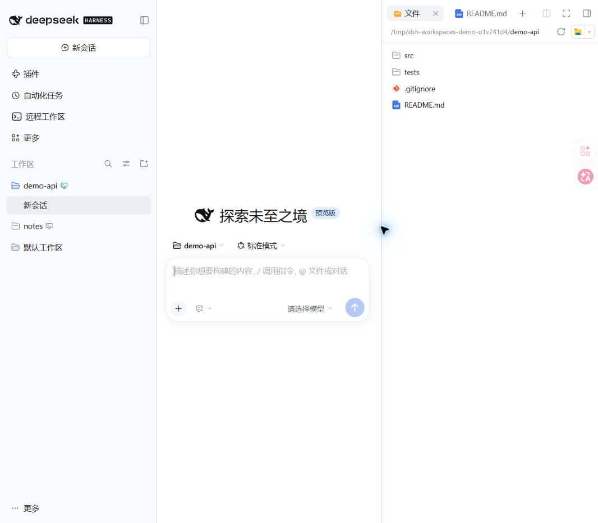
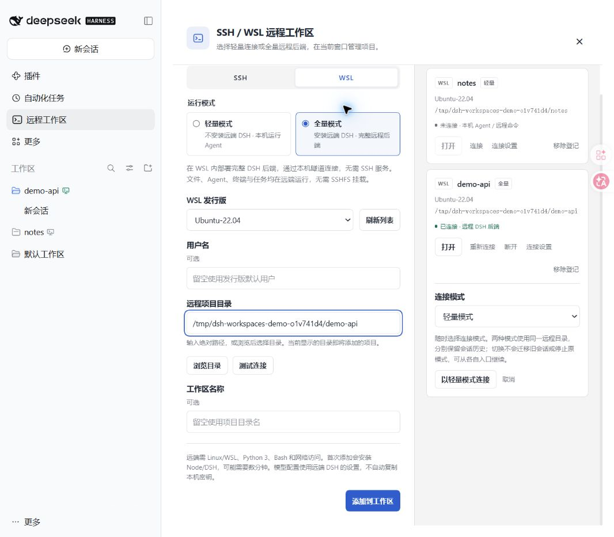

# DSH SSH / WSL Workspaces

**把 SSH 服务器和 WSL 里的项目，直接放进 DeepSeek Harness 当前窗口的项目侧栏。**

不用为每台机器再打开一个 DSH 窗口。在左侧 **远程工作区** 中添加目录，就能与本机项目一起管理；需要完整的远程开发环境时，还可以让 Agent、终端和任务在远端 DSH 中运行。

[npm 安装包](https://www.npmjs.com/package/dsh-ssh-workspaces) · [使用指南](https://github.com/czp0312/dsh-ssh-workspace/blob/main/docs/usage.md) · [问题反馈](https://github.com/czp0312/dsh-ssh-workspace/issues) · [MIT License](https://github.com/czp0312/dsh-ssh-workspace/blob/main/LICENSE)



> 截图来自真实 DSH 和 WSL 连接，使用独立的公开演示项目。

## 可以做什么

### 远程项目，也在原生侧栏里

- **同一个窗口管理本机、SSH 和 WSL 项目**：使用 DSH 原生工作区和会话列表。
- **独立的左侧入口**：点击「远程工作区」即可添加、浏览和管理连接。
- **远程目录浏览**：直接输入项目绝对路径，或浏览目录后添加。
- **可识别的远程标记**：项目标题旁显示主机图标，悬停可查看目标、连接状态和运行模式。

图标颜色会随连接状态更新：**绿色**为已连接，**灰色**为未连接，**黄色**为连接中，**红色**为连接异常。保存过项目，并不代表它当前在线。

### 轻量、全量两种模式，按项目选择

**轻量模式**适合沿用本机模型配置、主要读写文件和执行远程命令的场景。**全量模式**适合把 Agent、终端和任务都放在服务器或 WSL 里运行的场景。

| 能力 | 轻量模式 | 全量模式 |
| --- | --- | --- |
| 远端安装 DSH | 不需要 | 首次连接自动部署 |
| Agent 和模型配置 | 使用本机 DSH | 使用远端 DSH |
| 项目文件 | WSL 目录共享 / SSHFS 挂载 | 远端原生文件访问，无需 SSHFS |
| 执行命令 | 远程 Bash，每次独立执行 | 远端 DSH 原生工具 |
| 原生终端、后台任务、PTC、子代理 | 不支持，使用 Native 工具模式 | 接入远端 DSH，具体能力取决于其配置 |
| WSL 需要 SSH 服务 | 不需要 | 不需要 |

**模式以后也能切换。** 在已保存项目的「连接设置」中重新选择模式，再点击「以该模式连接」。两种模式使用同一个远程目录，分别保留工作区入口和会话历史；切回原模式后，可以继续原来的对话。

切换模式不会迁移旧对话，也不会停止原模式中正在运行的任务。SSH 切回轻量模式时，需要有对应的 SSHFS 挂载。



### SSH 支持密码、密钥和证书

轻量和全量模式均提供四种登录方式：

| 登录方式 | 如何使用 |
| --- | --- |
| 自动选择 | 沿用本机 OpenSSH 配置、默认私钥或 ssh-agent，支持 `~/.ssh/config` 的 Host 别名 |
| 仅密码 | 输入 SSH 登录密码，只尝试密码认证 |
| 密钥 | 选择或填写本机 OpenSSH 私钥路径；加密私钥可填写口令 |
| 证书 | 使用 OpenSSH 用户证书及配套私钥，需要服务器信任签发 CA |

桌面版支持选择密钥文件。密码和私钥口令只保留在本机 DSH 进程内，重启 DSH 后按需重新填写；连接记录只保存密钥和证书的路径，不上传私钥内容。


### 连接、断开、重连都有明确结果

- **打开**：在该项目中新建会话；继续旧对话请从侧栏选择原会话。
- **连接 / 重新连接**：恢复项目连接；需要补充密码或切换模式时，进入「连接设置」。
- **断开**：保留项目入口、文件和历史。手动断开后不会被状态刷新自动连回，重启客户端后也保持断开。
- **移除登记**：从项目列表撤下该模式的入口，保留远端文件和会话历史。

全量模式断开的是本机连接隧道，**远端 DSH 和任务继续运行**。多个全量项目共用同一后端时会一起离线，卡片中会提示影响范围。轻量模式断开会取消插件正在执行的远程命令，不会卸载你管理的 SSHFS 挂载。

## 安装

插件版本 **0.2.6**，已实机验证 **DSH 0.2.2-rc.1**。DSH 仍在快速更新，新版本需要进一步验证；声明的兼容范围不等于所有版本都已测试。

安装到官方桌面客户端的 `desktop` profile：

```powershell
dsh plugin --profile desktop add dsh-ssh-workspaces@0.2.6
```

使用 `dsh web` 时安装到 `web` profile：

```sh
dsh plugin --profile web add dsh-ssh-workspaces@0.2.6
```

**安装后重启客户端或 `dsh web` 一次。** 后续添加和打开远程项目都在原窗口中完成。自定义启动方式请将 profile 名替换为实际使用的名称。

找不到 `dsh` 命令时，可在官方客户端的「应用 → 管理 dsh 命令」中配置。也可以在客户端的插件管理界面中，使用 npm 包名 `dsh-ssh-workspaces` 安装。

## 第一次使用

### 添加 WSL 项目

1. 点击左侧 **远程工作区 → WSL**，选择已安装的发行版。
2. 选择轻量或全量模式。只需要本机 Agent 配合 WSL 文件和命令，可以先用轻量模式。
3. 填写 Linux 项目绝对路径，例如 `/home/dev/projects/demo`，也可以点击「浏览目录」。用户名留空时使用发行版默认用户。
4. 点击「测试连接」，再点击「添加到工作区」。
5. 在保存的项目卡片中点击「打开」，之后即可从侧栏进入项目和会话。

WSL 中需要 Python 3 和 Bash。全量模式首次连接还需要下载 Node / DSH；已有符合要求的 Node 时会复用。

### 添加 SSH 项目

1. 在终端用系统 `ssh` 登录目标机器，核对首次连接的主机指纹。
2. 点击 **远程工作区 → SSH**，填写主机或 SSH 别名、端口和用户名。
3. 选择登录方式，并填写密码、私钥或证书信息。
4. 选择运行模式并填写远程项目目录。轻量模式还需准备 SSHFS 挂载；全量模式无需挂载。
5. 测试连接，点击「添加到工作区」，然后打开项目。

**全量模式使用远端自己的模型配置。** 插件不会复制本机 API Key、登录信息或第三方插件。首次使用前，请为远端 DSH 配置可用的模型提供方，详见[全量模式准备](https://github.com/czp0312/dsh-ssh-workspace/blob/main/docs/usage.md#全量模式准备)。

## 使用前了解

- **当前主要面向 Windows 桌面客户端和 Linux / WSL 远端。** 全量后端要求 Linux；自动安装 Node 支持 x64 / arm64。macOS / Linux 本机的轻量 SSH 挂载路径支持尚未实机验证。
- **轻量 SSH 的挂载必须真实存在。** 普通本机文件夹不是 SSHFS 挂载；指定密码、密钥或证书时，需先用同一凭据建立挂载。
- **全量部署不需要 root。** DSH 安装在远端用户目录，服务只监听远端 `127.0.0.1`，经 SSH / WSL 通道连接。
- **首次 SSH 指纹核对在终端完成。** 插件遵循严格主机密钥校验，不会跳过未知或变更的主机指纹。

详细的认证、挂载、模型配置、模式切换和故障处理见[使用指南](https://github.com/czp0312/dsh-ssh-workspace/blob/main/docs/usage.md)。

## 开发与反馈

欢迎通过 [GitHub Issues](https://github.com/czp0312/dsh-ssh-workspace/issues) 反馈问题。请说明插件版本、DSH 版本、操作系统、SSH / WSL、运行模式和复现步骤；日志与截图中请先移除凭据及私人项目内容。

源码构建、验证和实现说明见[开发指南](https://github.com/czp0312/dsh-ssh-workspace/blob/main/docs/development.md)。参与维护请阅读 [AGENTS.md](https://github.com/czp0312/dsh-ssh-workspace/blob/main/AGENTS.md)，功能变更应同步更新使用文档和截图。

同窗远程项目的交互参考了 [ZCode](https://github.com/zai-org/ZCode)。项目基于 [DeepSeek Harness](https://github.com/deepseek-ai/deepseek-harness) 的插件机制开发，轻量 SSH 可搭配 [SSHFS-Win](https://github.com/winfsp/sshfs-win) 使用。
